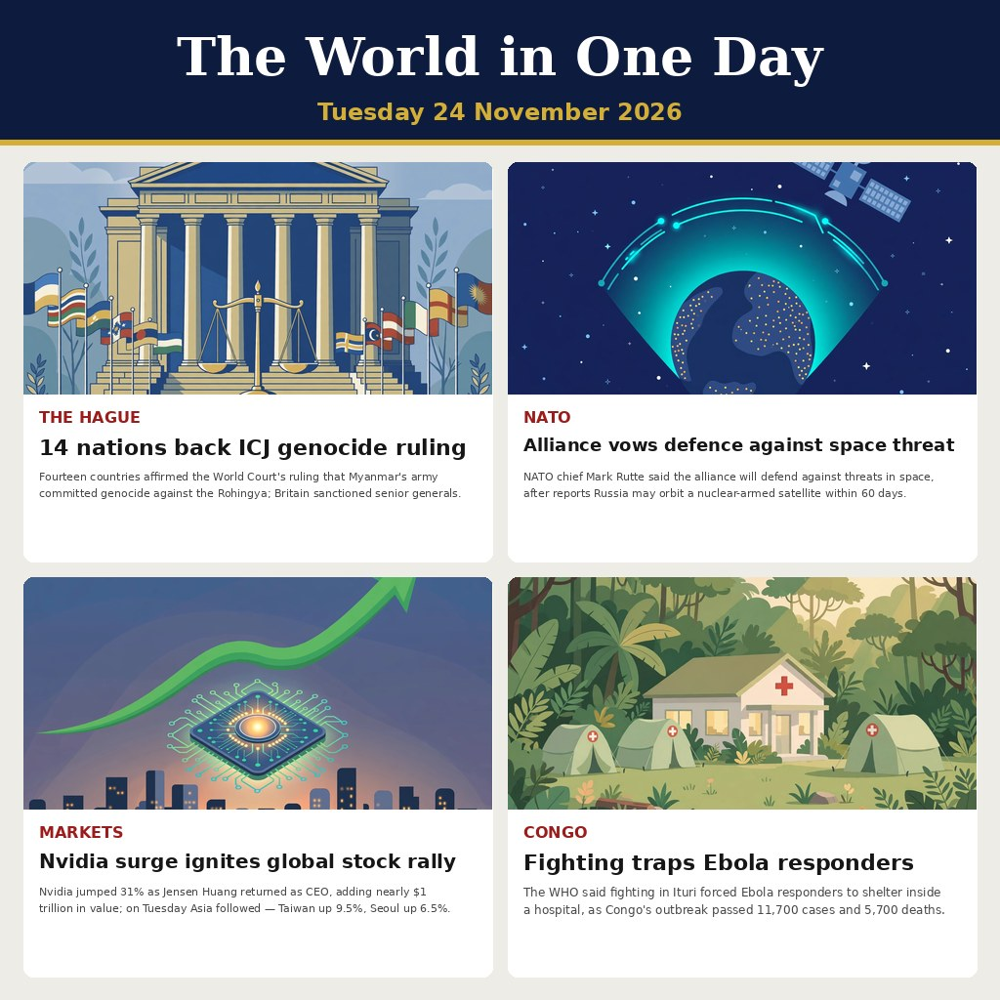

# The World in One Day — Tuesday 24 November 2026


This repository is my entry for the make.fun bounty [news-image-20261124](https://make.fun/c/news-image-20261124) ($100, 50 paid places): a single front-page image that sums up the world on Tuesday 24 November 2026 in four stories.



## The four stories

1. **THE HAGUE — 14 nations back ICJ genocide ruling.** Fourteen countries affirmed the World Court's ruling that Myanmar's army committed genocide against the Rohingya; Britain sanctioned senior generals. Sources: Daily Summary of World, Horizon, News Media House.
2. **NATO — Alliance vows defence against space threat.** NATO chief Mark Rutte said the alliance will defend against threats in space, after reports Russia may orbit a nuclear-armed satellite within 60 days. Sources: Daily Summary of World, News Media House.
3. **MARKETS — Nvidia surge ignites global stock rally.** Nvidia jumped 31% as Jensen Huang returned as CEO, adding nearly $1 trillion in value; on Tuesday Asia followed — Taiwan up 9.5%, Seoul up 6.5%. Sources: Reuters, The Hindu BusinessLine.
4. **CONGO — Fighting traps Ebola responders.** The WHO said fighting in Ituri forced Ebola responders to shelter inside a hospital, as Congo's outbreak passed 11,700 cases and 5,700 deaths. Sources: UN News, Reuters.

## How the image was made

The four scene illustrations were generated fresh in a flat editorial style with no text inside them. They were then composed into the 1024×1024 front page with compose.py using Python + Pillow and DejaVu fonts: a navy masthead with a gold date line above a 2×2 grid of white cards, each with a kicker, a one-line headline and a two-line body. The saved entry.png is a 1024×1024 JPEG under 1 MiB.

## Running it

```sh
mkdir -p out && MAKEFUN_OUTPUT_DIR=out node main.ts
```

This copies `entry.png` into the output directory (`out/` here, or `$MAKEFUN_OUTPUT_DIR` in general, defaulting to `/output`).
